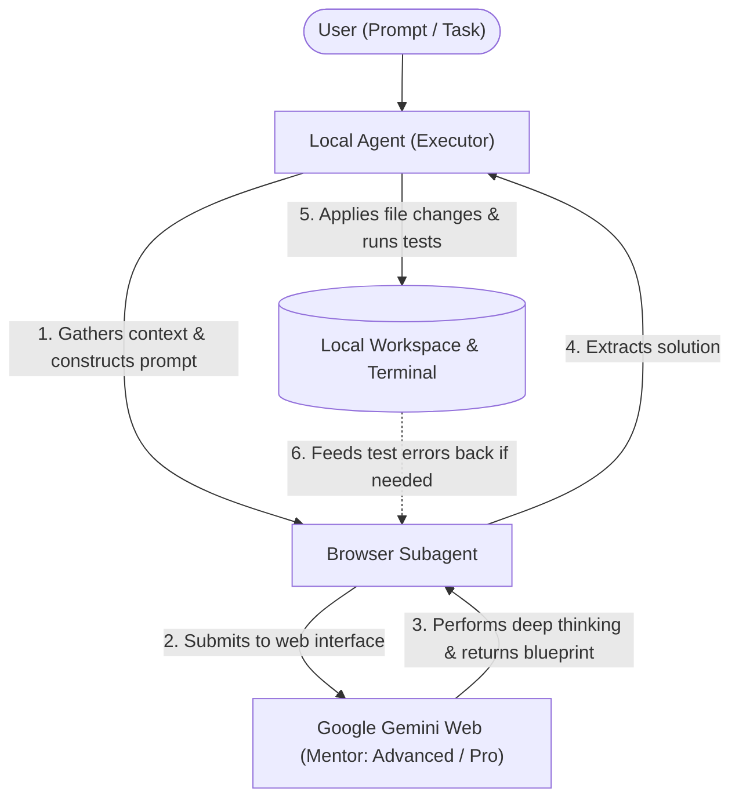

# Gemini Web Mentor Skill

[](https://github.com/MMMMON/gemini-web-mentor-skill)
[](LICENSE)

An intelligent agent skill and workflow protocol that establishes a **Dual-Agent Mentor-Executor Architecture** between an authenticated web session of Google Gemini (Gemini Advanced / Pro / Thinking models) and your local coding assistant.

---

## 💡 Overview

Users with **Google One AI Premium** or **Gemini Advanced** subscriptions have access to state-of-the-art reasoning and thinking models through `https://gemini.google.com`. 

The **Gemini Web Mentor Skill** bridges this web capability with your local IDE/agent environment:
- **The Mentor (Web Gemini)**: Functions as the Chief Architect and Strategic Planner, performing deep reasoning, architectural design, and complex problem decomposition.
- **The Executor (Local Agent)**: Functions as the Local Engineer, harvesting local project context, communicating with Web Gemini via a sandboxed browser subagent, extracting blueprints, modifying local files, and running build/test pipelines.



---

## ✨ Key Features

- **Leverage Your Pro / Advanced Subscription**: Utilize the full power of your web subscription directly inside your local developer workflow.
- **Dual-Agent Specialization**: Separates high-level architectural cognition from precise local tool execution.
- **Session Persistence**: Reuses authenticated browser sessions across conversations without requiring repeated logins.
- **Closed-Loop Feedback**: If local tests or builds fail, error traces are fed back to the Web Gemini thread for iterative debugging.
- **Universal Compatibility**: Works as a native Antigravity skill, project rule, or standalone agent procedure.

---

## 📂 Repository Structure

```text
gemini-web-mentor-skill/
├── .agents/
│   └── skills/
│       └── gemini-web-mentor/
│           └── SKILL.md         # Antigravity skill definition
├── gemini-web-mentor/
│   └── SKILL.md                 # Standalone skill file
├── rules/
│   └── GEMINI.md                # Companion workspace rule for auto-activation
├── README.md                    # English documentation
└── LICENSE                      # MIT License
```

---

## 🚀 Getting Started

### 1. Installation

#### Option A: Workspace Skill (Recommended)
Copy the skill into your project's `.agents/skills` directory:

```bash
mkdir -p .agents/skills/gemini-web-mentor
cp gemini-web-mentor/SKILL.md .agents/skills/gemini-web-mentor/SKILL.md
```

#### Option B: Global / Workspace Rule
Place `rules/GEMINI.md` (or append its contents) into your project root as `GEMINI.md`:

```bash
cp rules/GEMINI.md ./GEMINI.md
```
Antigravity automatically discovers and loads `GEMINI.md` at turn 0 for any new conversation in that workspace.

---

### 2. One-Time Browser Authentication

1. In your agent conversation, ask the agent to open the browser:
   > "Open https://gemini.google.com in the browser."
2. The agent launches an integrated browser tab.
3. In the browser view, manually sign in to your Google Account with your Gemini Advanced / Pro subscription.
4. Once signed in, the session cookies are automatically saved to your local browser profile.

---

### 3. Usage & Workflow

Once authenticated, you can trigger this workflow at any time:

#### Explicit Trigger
> "Consult Web Gemini to design the architecture for our new real-time WebSocket service, then implement it locally."

#### Automatic Rule Activation
With `GEMINI.md` active, the agent automatically consults Web Gemini whenever a task involves:
- Multi-component system architecture.
- Difficult algorithm design or performance optimization.
- Complex refactoring across multiple files.
- Tricky bug diagnostics requiring deep thinking.

---

## 🔒 Security & Privacy

- **Protected Authentication**: Google Account authentication is performed directly by the user in the browser window. Credential entry is never automated or stored in code.
- **Local Isolation**: All file operations and shell commands run inside your configured local workspace and sandbox boundaries.
- **Data Minimization**: Only project-relevant context, file snippets, and error traces are passed to the Web Gemini session.

---

## 📄 License

This project is licensed under the [MIT License](LICENSE).
