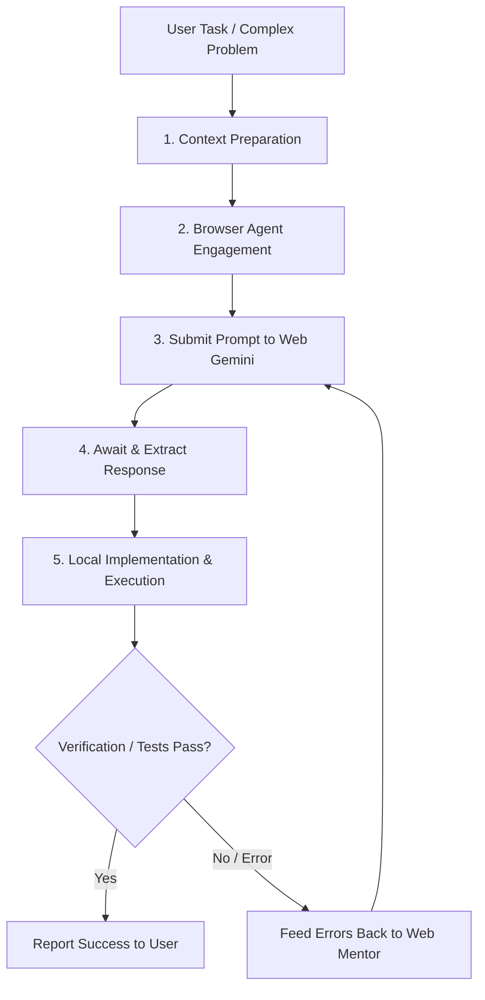

# Gemini Web Mentor Skill

This skill operationalizes a **Dual-Agent Mentor-Executor Architecture**:
- **Mentor (Web Gemini)**: Utilizes an active, authenticated web session of Google Gemini (Gemini Advanced / Pro / Thinking model) to provide deep architectural reasoning, strategic planning, algorithm design, and code blueprints.
- **Executor (Local Agent)**: Acts as the hands and eyes on the local machine—collecting project context, passing instructions to the web mentor, retrieving generated solutions, editing files, running commands, and validating tests.

---

## Workflow Procedure

### Step 1: Context Preparation
Before consulting the web mentor, collect necessary local context so that Web Gemini has sufficient background:
1. Locate relevant source files and configuration files.
2. Extract targeted snippets or concise summaries (avoid exceeding browser input comfort limits).
3. If debugging, capture exact terminal outputs, exception stack traces, or compiler errors.
4. Formulate a structured prompt containing:
   - **Role & Goal**: Clear specification of the desired architecture or fix.
   - **Environment**: OS (Windows), language versions, dependencies, and constraints.
   - **Context**: File structures and code excerpts.
   - **Expected Output**: Concrete file structure, function implementations, and step-by-step instructions.

### Step 2: Browser Agent Engagement
1. Use the `browser` subagent (or reuse an existing idle browser subagent session if available).
2. Ensure the active tab is at `https://gemini.google.com/app`.
3. Check that the user's session is authenticated (e.g., prompt input box is visible).

### Step 3: Prompt Submission
1. Target the prompt input textarea (`textbox "为 Gemini 输入提示"` or `textbox "问问 Gemini"`).
2. Input the prepared prompt.
3. Submit via enter key or by clicking the send button (`button "发送提示"` / `button "Submit"`).

### Step 4: Await & Extract Response
1. Wait for Web Gemini to finish streaming its reasoning and final output (check that streaming indicators stop and the copy/action buttons appear).
2. Extract the complete response text and markdown code blocks.
3. Parse the high-level plan, architecture decisions, and code changes proposed by the model.

### Step 5: Local Implementation & Execution
1. Take the blueprints provided by Web Gemini and implement them precisely on the local machine:
   - Use `write_file` or `edit_file` to create or modify local source files.
   - Use `run_command` to install dependencies, run build tools, or execute tests.
2. Follow standard local development hygiene (run sandboxed first, avoid unnecessary modifications).

### Step 6: Verification & Iterative Loop
1. Run local tests or build commands to verify the solution.
2. If tests pass, deliver the final summary and clickable file links to the user.
3. If an unexpected error or edge case occurs:
   - Bundle the error logs.
   - Submit a follow-up query to the same Web Gemini conversation thread.
   - Incorporate the mentor's updated recommendations.

---

## Best Practices
- **Session Preservation**: Do not sign out or clear browser storage. Leave the browser subagent idle when inactive so session tokens remain intact.
- **Clear Prompt Framing**: Always specify in the web prompt that the output will be executed locally by an automated assistant, requesting clean code blocks and explicit file targets.
- **Deep Research Encouraged**: For complex architectural designs, cross-framework technical evaluations, or in-depth domain modeling, actively leverage and encourage Gemini's **Deep Research (深入研究)** mode to formulate comprehensive blueprints.
- **Autonomous Quota Fallback (Pre-Authorized)**: If Web Gemini encounters rate limits or quota depletion, autonomously transition to Perplexity Pro (leveraging Kimi K3 Thinking, GLM 5.3 Thinking, or Claude Sonnet 5.5) to finish the task without asking the user for permission.
